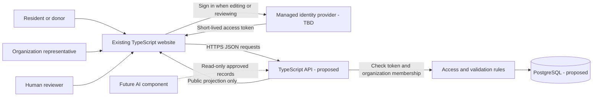

# Architecture

The website asks the API for information. The API checks the request and reads or changes the database. A separate identity provider handles signing in.

## Request examples

**Resident:** `GET /api/v1/services?area=us-pa&category=food` requires no account. The API returns only eligible public fields. Real deployments reject or hide demo records.

**Organization:** a member sends `POST /api/v1/services` with an access token and organization ID. The API verifies the token, loads the member's approved organization membership, validates the body, then creates a draft. An organization ID supplied in the body is not proof of membership.

**Reviewer:** the API verifies the platform reviewer role, rejects members of the subject organization, locks the service row and verifies the submitted content version. The review entry and status/verification update commit in one transaction.

## Deployment boundary

The current Vercel configuration sends all routes to the static frontend. It cannot serve these new endpoints as written. During implementation, choose either a separate API origin or real server functions with routing configured before the SPA fallback. Add a frontend API base URL and an explicit CORS allowlist if origins differ.

Keep database credentials and identity-provider secrets in the server environment. Vite variables exposed to browser code must not contain secrets. The browser never connects using a privileged database credential.

## Future AI boundary

Penuel's future AI component receives the same approved public service records that residents can see, including IDs, source URLs, and verification dates. It returns service IDs with explanations grounded in those records. The API rechecks their visibility before display. No recommendations when no matching checked records exist; no AI-generated addresses, hours, eligibility or approval decisions. The AI component has no database write or review permission.

No AI endpoint or provider is included in this MVP contract. Exact request/response format is a later joint decision.
