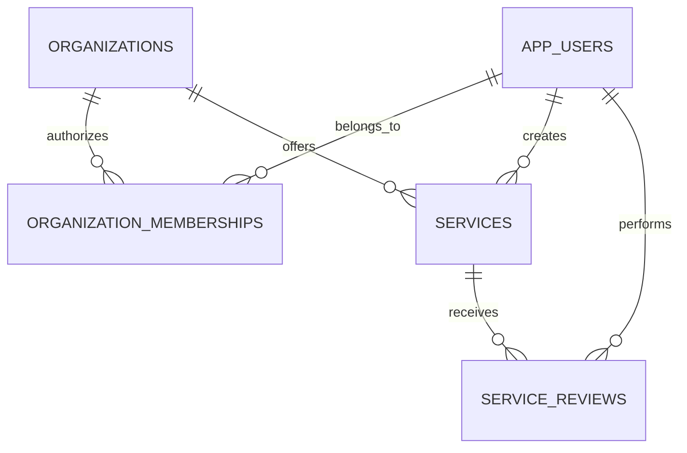

# Database schema, in plain language

A schema is a description of what we store and how records are connected. [schema.sql](schema.sql) is a PostgreSQL design draft, not an applied migration.

## Five tables

| Table | Meaning | Main fields |
| --- | --- | --- |
| `app_users` | Signed-in staff or organization representatives | Internal ID, identity issuer and subject, display name, platform role |
| `organizations` | A provider of support | ID, name, description, public contact URL, demo flag |
| `organization_memberships` | Approved permission to manage an organization | User ID, organization ID, grantor and grant date |
| `services` | One support listing | Organization, title, category, area, description, eligibility, schedule, cost, preparation, contact/source URLs, optional address and coordinates, donor support instructions, workflow and verification fields |
| `service_reviews` | A decision about a particular version | Service, reviewer, content version, decision, note, snapshot, time |

Users have a platform role of `member`, `reviewer` or `admin`. Organization editing requires a membership, not just the `member` role. Memberships exist only after manual approval; pending signup requests are not stored as effective memberships. Visitors do not need a user row.

## Key distinctions

- An **organization** is the provider; a **service** is a particular offering. One provider can have several listings.
- `updated_at` means someone changed the stored record. `last_verified_at` means a reviewer checked its current content.
- `version` is a content version. Increment it only on content changes. Status transitions alone do not increment it.
- `approved_version` must equal `version` before a listing is public.
- `verification_expires_at` limits how long an approval is treated as current. Proposed initial policy: 30 days from approval, calculated by the server.
- `is_demo` identifies fictional data. It is assigned by trusted fixture/import tooling, never by a public request.
- `area_slug` is an exact pilot-area key, not a distance calculation.
- `schedule` is readable text initially. Do not calculate an “open now” badge from it.
- `address` and coordinates may be absent, such as for mobile or delivery programs. No marker or directions link without a checked location. Coordinates, when present, are WGS84 latitude/longitude.

## Version example

Version 1 is approved. An organization changes its hours using `expected_version: 1`. The API saves version 2 as a draft and clears approval timestamps. It disappears from public search. After submission and review, version 2 can be approved. Version 1's review snapshot remains in the history.

## SQL boundaries

The draft defines types, lengths, keys, paired coordinates and a public visibility view. It does **not** implement authentication, endpoint authorization, role provisioning, state transitions, timestamp maintenance or append-only review enforcement. Those must be implemented and tested in the API/DB access layer before launch. A database view is not an authorization policy.

The API must own all writes. Do not expose tables directly to the browser. Restrict the runtime database role and review whether row-level policies are needed once the hosting/auth approach is selected.

## Mapping the existing frontend

| Existing `Resource` field | Proposed API field |
| --- | --- |
| `id` | `id` (new UUID; adapter needed for existing slug URLs) |
| `title`, `category`, `description` | Same names |
| `cityId` | `area_slug` |
| `offers` | `offers` |
| `eligibility`, `schedule`, `cost`, `preparation` | Same names |
| `landing` | Presentation-only metadata; do not store in service records |

New fields include organization attribution, public contact/source URLs and verification timestamps. The frontend should use an adapter rather than assuming its current hard-coded `CityId` union matches the API. Preserve existing demo routes until that integration is deliberately implemented.
