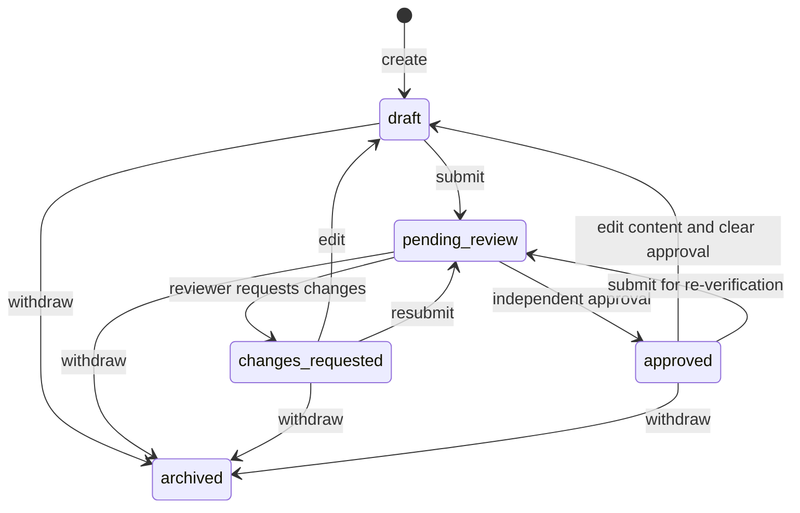

# Access, validation and updates

## Who can do what?

| Action | Visitor | Organization member | Reviewer | Admin |
| --- | --- | --- | --- | --- |
| Read approved public records | Yes | Yes | Yes | Yes |
| Create/edit/submit a listing | No | Own organization | Only with membership | Only with membership |
| Read nonpublic organization records | No | Own organization | Submitted review queue only | Review queue or authorized admin tooling |
| Approve/request changes | No | No | Yes, except own organization or own submission | Same independence rule |
| Archive a listing | No | Own organization | No | Yes |
| Grant memberships or platform roles | No | No | No | Manual, audited setup |

A reviewer who also belongs to an organization cannot review its listings. Keep the platform role and organization membership checks separate. Users cannot assign themselves a role, claim any organization ID, or edit access fields through a listing request.

## Identity checks

Use HTTPS. Verify access tokens server-side using the chosen provider's supported verification mechanism, including signature, issuer, audience, expiry and allowed algorithm when JWTs are used. Map the validated `(issuer, subject)` to an internal user. Read roles and memberships from trusted server-side records. Do not trust a role in a request body or an unsigned token payload.

Require authorization at every endpoint and for each target object. Keep tokens out of URLs and logs. Client token storage/session handling is a provider-selection decision; if cookies are selected, add explicit CSRF protection. Never ship database secrets or identity admin keys to browser code.

## Submission rules

- Required: organization, title, food category, supported area, description, eligibility, schedule, cost, preparation, offers, contact URL and source URL.
- Normalize whitespace and enforce the sizes in the API schema. Accept plain text, not HTML.
- Contact and source URLs must be HTTPS. The first API will store reviewed URLs; it will not automatically fetch arbitrary submitted URLs.
- At least one offer; no duplicate empty entries. Blank donor support instructions mean no donor action is shown.
- Coordinates must be supplied as a pair and within valid ranges. They must be checked before a public map marker is shown.
- A human verifies opening hours, eligibility, contact route and whether the provider actually offers the service. Record how it was checked in the review note, which is visible to that organization and eligible reviewers but not the public. Keep personal data out of notes.
- Unknown information must be resolved before approval. A plausible-looking value is not evidence.
- `.example` contact/source URLs and fictional records are accepted only in the isolated local demo fixture flow; reject them during real pilot onboarding.

## Workflow

Only content edits increment `version`. Edit is allowed in draft, changes_requested or approved. Submit is allowed in draft, changes_requested or approved, requires the current version and complete fields, and clears existing verification. Archive is allowed from any non-archived state and clears verification. Reviews require pending_review and the current version. Archived is terminal in this MVP.

Approval sets `approved_version = version`, `last_verified_at = server time`, and `verification_expires_at = server time + 30 days`. Requesting changes clears these fields. Store a review snapshot of the exact content version for either decision. State update and history insert are one transaction; failure rolls back both.

Expiration is a query-time rule, not a stored boolean. A record can remain status `approved` but be invisible because its verification expired. The organization's management view should show “Needs re-verification.” Exact expiry (`expires_at <= now`) means hidden, even if no background job has run.

## Operational questions before real launch

Choose the first PA collection area, real reviewer, source of initial records, ownership proof, review capacity and expiration interval. Provide a monitored way to report incorrect information. Decide retention for account data and private review notes. The pilot does not collect resident medical history, eligibility documents or donation payments.
