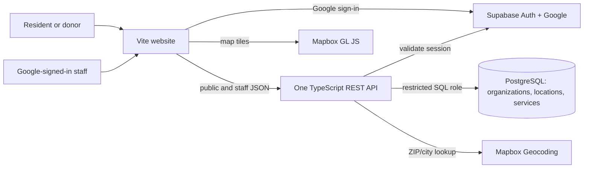

# Architecture recommendation

**One frontend, one API, one database.** Keep the current Vite/TypeScript website. Add a small TypeScript REST API at `/api/v1`, hosted as Vercel Functions if the team retains its existing Vercel project. Use Supabase PostgreSQL for records and Supabase Auth for Google sign-in. Use Mapbox for ZIP/city geocoding and map tiles when the team selects a map account. There is no need for microservices, queues or AI infrastructure.

## Technology choices

| Component | Recommendation | Reason / tradeoff |
| --- | --- | --- |
| Frontend and API host | Existing Vite app plus root `api/` Vercel Functions | Reuses the current codebase and keeps one HTTP origin. The existing SPA fallback must leave `/api/*` routes reachable. Vercel documents root API functions in Vite projects. [Vite on Vercel](https://vercel.com/docs/frameworks/frontend/vite). |
| Database | Supabase PostgreSQL, with PostGIS for radius search | Organizations, sites and services have clear relationships; PostGIS can search indexed geographic points. It is a managed dependency and the team must set up migrations. [Supabase PostGIS guide](https://supabase.com/docs/guides/database/extensions/postgis). |
| Login | Supabase Auth with Google provider | Google handles account authentication; Our Ground stores only its own role/membership mapping. Set up a Google OAuth web client, the Supabase callback URI, and app redirect URLs. [Supabase Google sign-in](https://supabase.com/docs/guides/auth/social-sign-in/auth-google), [Google OAuth redirect guidance](https://developers.google.com/identity/protocols/oauth2/web-server). |
| Map and place search | Mapbox GL JS plus Geocoding API | Supports a browser map and conversion of ZIP/city text to coordinates. Usage terms and spending limits need an account-owner decision. [Mapbox GL JS](https://docs.mapbox.com/mapbox-gl-js/guides/), [Geocoding API](https://docs.mapbox.com/api/search/geocoding/). |

## How a request works

1. A visitor enters a ZIP or city. The API resolves it and rejects locations outside Pennsylvania.
2. The browser requests nearby services by coordinate, radius and category. The API returns published records with list fields and map points. Distance is straight-line miles, not driving distance.
3. A visitor opens a service detail and can view its source date and contact/directions **only when those fields represent a sourced real record**. A fictional demo record has those actions disabled.
4. An account holder chooses “Continue with Google.” Supabase handles the sign-in redirect and returns an app session. The API validates the session and looks up Our Ground's own role/membership record before allowing edits. A newly registered Google account is a normal user with no editing rights.

Google sign-in requires a configured Google OAuth client and exact authorized redirect URI; basic identity scopes are enough for this prototype. No Google Drive, Gmail or other Google data access is requested. [Supabase Google sign-in](https://supabase.com/docs/guides/auth/social-sign-in/auth-google), [Google OAuth scopes/redirects](https://developers.google.com/identity/protocols/oauth2/web-server).

## Database and secret boundary

The browser calls the Our Ground API for directory data. Put application tables in a private PostgreSQL schema outside the Supabase Data API's exposed schemas; the API uses a restricted database role and checks ownership on every write. Supabase documents private schemas and explicit API exposure. [Supabase tables/schemas](https://supabase.com/docs/guides/database/tables), [API security](https://supabase.com/docs/guides/api/securing-your-api).

Vercel Functions connecting directly to Supabase PostgreSQL should use its transaction-mode pooler with a small connection pool; the database URL, Google client secret and any private map credential stay server-side. Only a public map token belongs in browser configuration. [Supabase connection guide](https://supabase.com/docs/guides/database/connecting-to-postgres), [Vercel environment variables](https://vercel.com/docs/environment-variables).

## Scope tradeoffs

- The UI can show Pennsylvania as the selected state while demo records cover only a few cities. Search should say when the selected area has no demo records.
- The map is a visual aid; the list and details still work if map tiles fail.
- No verification badge, last-verified date or service-availability guarantee appears in the MVP. The “trust and verification” mockup remains a later product concept.
- Hosting, database, Google OAuth and maps each need setup and account ownership. The presentation can explain this architecture without provisioning anything yet.
