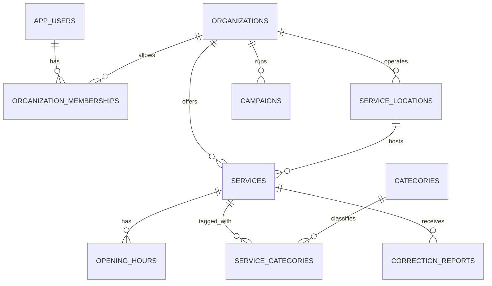

# Simplified data model

This is a logical schema for a Pennsylvania prototype. **Organizations, service locations and services stay separate**: one organization can operate several sites, and one site can offer several services. The MVP has no verification-review table, approval version, expiry timestamp or verified flag.

## Proposed tables

| Table | Key fields | Constraints and purpose |
| --- | --- | --- |
| `app_users` | `id` (Supabase Auth user ID), `role` (`user` or `admin`), `created_at` | On first successful Google sign-in, the API creates this app row with `role='user'`. Residents can browse without one. Role changes are admin-only. |
| `organizations` | `id`, `name`, `description`, `website_url`, `public_phone`, `status`, `is_demo`, `updated_at` | `status` is `draft`, `published` or `hidden`. A published demo organization remains labeled fictional. |
| `organization_memberships` | `organization_id` FK, `user_id` FK, `role` (`editor`), `granted_by`, `granted_at` | Unique active organization/user pair. A Google account does not create membership automatically. |
| `service_locations` | `id`, `organization_id` FK, `site_name`, street address, `city`, `state`, `postal_code`, `point`, `source_url`, `source_recorded_at`, `status`, `is_demo`, `updated_at` | `state='PA'` for MVP. Store WGS84 `geography(Point,4326)` for map/distance. A service cannot be published with a missing map point in the map workflow. |
| `services` | `id`, `organization_id` FK, `location_id` FK, `title`, `summary`, `description`, `eligibility_text`, `cost_summary`, `appointment_note`, `contact_phone`, `contact_url`, `source_url`, `source_recorded_at`, `status`, `is_demo`, `version`, `updated_at` | Composite FK `(location_id, organization_id)` ensures the site belongs to the same organization. `version` supports conflict checks. No field implies current availability. |
| `categories` | `id`, unique `slug`, `name` | Seed `food` and `healthcare`. |
| `service_categories` | `service_id` FK, `category_id` FK | Composite primary key; at least one category required for a published service. |
| `opening_hours` | `id`, `service_id` FK, `weekday`, `opens_at`, `closes_at`, `notes`, `sequence` | Multiple daily intervals allowed; times must be ordered and nonoverlapping. Store “hours may change” as UI copy; no “open now” calculation in the MVP. |
| `correction_reports` | `id`, `service_id` FK, `reason_code`, optional `description`, `status`, `created_at`, `resolved_at` | Anonymous report, no required email/name. `status` is `open` or `resolved`. Private text is visible only to admins. |
| `campaigns` | `id`, `organization_id` FK, `title`, `summary`, `category_id` FK, `goal_cents`, `demo_raised_cents`, `currency`, `impact_text`, `status`, `is_demo` | Seeded fictional display only. No donor or card records and no payment totals in the MVP. |

PostgreSQL keys, foreign keys and checks protect relationships; PostGIS supplies indexed geographic points and radius queries. [PostgreSQL constraints](https://www.postgresql.org/docs/current/ddl-constraints.html), [Supabase PostGIS](https://supabase.com/docs/guides/database/extensions/postgis).

## Indexes and search

- GiST index on `service_locations.point`. Use `ST_DWithin` to filter by radius and `ST_Distance` to calculate straight-line distance; `geography` distances are in meters. [PostGIS radius-search guidance](https://postgis.net/documentation/tips/st-dwithin/).
- B-tree indexes on `services(location_id,status)`, `services(organization_id,status)`, `service_categories(category_id,service_id)` and `correction_reports(status,created_at)`.
- Search only `published` organizations, locations and services. In a presentation/demo environment, return `is_demo=true` records with a visible “fictional demo” label. Any later real public mode excludes demo records by default.

## Provenance, updates and duplicates

`source_url` and `source_recorded_at` tell where and when a real record was copied; they are **not verification**. `updated_at` means the database record changed. The UI must not display “verified,” “last verified,” “open now” or “available today.” Missing eligibility/hours are shown as unknown, not guessed.

A staff editor can update a record belonging to their assigned organization; the API increments `version` and `updated_at`. The editor can set `draft`/`published` for that organization in the prototype. An admin can hide a record after a credible correction report. Duplicate candidates are found by normalized organization name, address, phone and nearby point, then handled manually; do not auto-merge similar names.

For the presentation, keep all sample organizations, sites, services and campaigns obviously fictional. Use unusable demo contact/address text and disable call/directions/donate actions on them. A later real-data phase needs source permission, a maintenance owner and an accuracy policy before genuine contact/directions information is offered.

## Campaign totals later

For the demo, `demo_raised_cents` is a seeded fictional number and the UI labels it as such. A real donation feature would need a payment provider, webhook event IDs, refunds, and idempotent accounting; the browser must never set a real raised total. Stripe's Checkout API distinguishes one-time payment and subscription modes, but neither is part of this MVP. [Stripe Checkout Sessions](https://docs.stripe.com/api/checkout/sessions/create).
